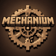

# MECHANIUM



**MECHANIUM** é um plugin independente para Minecraft, voltado a tecnologia, progressão histórica, indústria, automação e geopolítica.

- **Minecraft:** 1.21.11
- **Java:** 21
- **Servidores-alvo:** Paper e Purpur
- **Distribuição:** um único `MECHANIUM.jar`
- **Módulos oficiais:** incorporados ao JAR e ativados por configuração
- **Addons externos:** suportados por uma API pública versionada
- **Dependências:** nenhuma dependência obrigatória de Slimefun ou Historical Ages

## Decisões de arquitetura

1. MECHANIUM não carrega Slimefun nem Historical Ages como dependências.
2. Conceitos e funcionalidades desses projetos serão reimplementados em APIs próprias; código upstream só será portado após auditoria de licença e atribuição.
3. Módulos históricos/industriais formam o conjunto padrão.
4. Fantasia e ficção futurista ficam em módulos internos separados, desativados por padrão.
5. Addons comunitários são JARs externos carregados por `plugins/MECHANIUM/addons/`.
6. A progressão é consultada pelo serviço central. Módulos não devem criar listas duplicadas de eras nem contornar o motor.

## Estrutura Maven

| Módulo | Responsabilidade |
|---|---|
| `mechanium-api` | API pública para módulos e addons |
| `mechanium-storage` | Persistência SQLite e migrações |
| `mechanium-engine` | Eras, pesquisas e autorização tecnológica |
| `mechanium-modules` | Módulos oficiais, inclusive opcionais |
| `mechanium-addon-loader` | Descoberta, dependências e ciclo de vida de addons externos |
| `mechanium-plugin` | Bootstrap Bukkit e montagem do JAR único |

## Compilar

Requer JDK 21 e Maven 3.9+:

```bash
mvn clean verify
```

JAR principal:

```text
mechanium-plugin/target/MECHANIUM-0.7.4.01-SNAPSHOT.jar
```

A linha 0.7.4.01-SNAPSHOT acrescenta uma Carteira EMC diretamente no HUD. A linha 0.7.4 adiciona a primeira implementação de equivalência EMC, com saldo por jogador, dissolução, síntese, catálogo aprendido e cinco níveis de estações. Consulte [EMC Exchange](docs/EMC_EXCHANGE.md) para uso, configuração e limitações.

## Instalar

1. Faça backup do servidor.
2. Copie o JAR MECHANIUM para `plugins/`.
3. Inicie Paper/Purpur 1.21.11.
4. Ajuste `plugins/MECHANIUM/config.yml`.
5. Coloque addons externos em `plugins/MECHANIUM/addons/` e reinicie.

A linha 0.7.0.01 amplia os módulos Forestry, Textile Industry, Biofuel, Construction Materials, Networks e Better Reactor (geração fictícia por cristais), incluindo transporte local de itens MECHANIUM por conduítes. A linha 0.6.0 adiciona cinco domínios industriais: filtragem do ar, metalurgia avançada, engenharia de pressão, automação industrial e logística. Também inclui um catálogo de fabricação por clique e recompensas científicas por descobertas minerais e avanços. A linha 0.5.0 acrescentou ElectricSpawners, FastMachines e HardcoreSlimefun. A linha 0.4.1 também traz pesquisas temporizadas com duração dinâmica e progresso offline, e 0.4.0 ampliou o catálogo vanilla e trouxe as primeiras cadeias ExoticGarden/DankTech2. A expansão 0.7.0.01 acrescentou oito geradores de materiais passivos. A expansão 0.7.1.00 acrescentou quatro domínios: tratamento de água, estufas/hidroponia, reciclagem industrial e fragmentação de minérios. A expansão 0.7.2.00 acrescenta cinco domínios: aquicultura, vidro industrial, carga ferroviária, fabricação de baterias e cadeia de frio. O projeto segue experimental e precisa de validação funcional em Paper/Purpur 1.21.11. Consulte [STATUS](docs/STATUS.md), [MÓDULOS](docs/MODULOS.md) e [ROADMAP](docs/ROADMAP.md).

## CI e estado

- O CI da linha 0.5.0 deve validar Java 21 / Maven verify antes de considerar o snapshot pronto.
- O [pré-release mais recente](https://github.com/davitremea1-ops/MECHANIUM/releases/tag/snapshot) deve conter o JAR correspondente ao snapshot após o CI desta atualização.
- A versão é experimental. O build automatizado não substitui o teste de gameplay em Paper/Purpur.

## Documentação

- [Wiki completa em português](docs/wiki/README.md) — guia de jogadores, sistemas, módulos, comandos, administração e desenvolvimento.
- [Arquitetura](docs/ARQUITETURA.md)
- [Painel administrativo e configuração de progressão](docs/ADMINISTRACAO.md)
- [Desenvolvimento de addons externos](docs/ADDONS_EXTERNOS.md)
- [Projeto-exemplo de addon Maven](examples/mechanium-addon-example/README.md)
- [Módulos oficiais e opcionais](docs/MODULOS.md)
- [Equivalência EMC](docs/EMC_EXCHANGE.md)
- [Matriz de portabilidade](docs/PORTABILIDADE_ADDONS.md)
- [Licenças e atribuição](docs/LICENCAS_E_ORIGENS.md)
- [Roadmap](docs/ROADMAP.md)
- [Política de versionamento até 0.9.9](docs/VERSIONAMENTO.md)
- [Contribuição](CONTRIBUTING.md)
