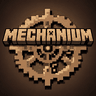

# Wiki oficial do MECHANIUM

> Manual em português para jogadores, administradores e desenvolvedores. Esta documentação acompanha a linha **0.9.9.00-SNAPSHOT** (em consolidação) do repositório.

## Sobre o plugin

MECHANIUM é um plugin independente para Minecraft, criado para combinar progressão por eras históricas, pesquisas, fabricação, máquinas, energia, armazenamento, logística e módulos industriais. Os módulos oficiais vêm no próprio JAR; addons comunitários podem ser instalados separadamente.

| Requisito | Alvo |
|---|---|
| Minecraft | 1.21.11 |
| Servidor | Paper ou Purpur |
| Java | 21 |
| Distribuição | Um JAR principal |
| Dados | SQLite |
| Integração externa | API MECHANIUM para addons |

MECHANIUM não exige Slimefun nem Historical Ages para funcionar. Implementações inspiradas em conceitos de outros projetos são independentes; consulte a [política de licenças e origens](../LICENCAS_E_ORIGENS.md).

## Comece por aqui

- [Primeiros passos do jogador](PRIMEIROS-PASSOS.md) — livro-guia, menus, eras, pesquisas, pontos científicos e fabricação.
- [Sistemas e mecânicas](SISTEMAS.md) — explicação de progressão, máquinas, energia, fluidos, armazenamento, redes, EMC e demais sistemas.
- [Catálogo de módulos](CATALOGO-DE-MODULOS.md) — módulos conhecidos, finalidade, estado e limitações.
- [Comandos e configuração](COMANDOS-E-CONFIGURACAO.md) — comandos de jogador e staff, permissões e opções do config.yml.
- [Guia de administração](ADMINISTRACAO.md) — instalação, atualização, backups, progressão global e edição de receitas.
- [Desenvolvimento de addons](DESENVOLVIMENTO.md) — API, descriptor, compilação e instalação de extensões.

## Documentação técnica complementar

- [Arquitetura interna](../ARQUITETURA.md)
- [Painel administrativo detalhado](../ADMINISTRACAO.md)
- [Módulos oficiais — referência técnica](../MODULOS.md)
- [Sistema EMC — tutorial e configuração](../EMC_EXCHANGE.md)
- [Addons externos — contrato da API](../ADDONS_EXTERNOS.md)
- [Estado real e limitações conhecidas](../STATUS.md)
- [Roadmap](../ROADMAP.md)
- [Plano de consolidação 0.9.9](../PLANO-0.9.9.md)
- [Política de versionamento](../VERSIONAMENTO.md)
- [Licenças e atribuição](../LICENCAS_E_ORIGENS.md)
- [Changelog](../../CHANGELOG.md)

## Como interpretar os estados

Esta Wiki diferencia três situações:

- **Implementado:** existe uma implementação descrita no código e na documentação do projeto.
- **Parcial / limitado:** existe uma primeira versão jogável, mas faltam recursos, automação, integração ou paridade com a referência original.
- **Planejado / pendente:** aparece no roadmap, mas não deve ser tratado como funcionalidade disponível.

Um build Maven bem-sucedido confirma a compilação e os testes automatizados executados pelo CI. Ele não comprova, por si só, que menus, receitas, máquinas e persistência foram validados em um servidor real. A validação completa em Paper/Purpur 1.21.11 permanece um critério separado.

## Visão rápida do fluxo de jogo

1. O jogador recebe o livro-guia e abre o menu do MECHANIUM.
2. Consulta a era efetiva do servidor e a árvore de tecnologias.
3. Obtém pontos científicos e inicia pesquisas disponíveis.
4. Fabrica componentes e estações no menu **Crafting** ou nas receitas suportadas.
5. Monta máquinas e redes locais para processar materiais.
6. Usa a **Wiki** do jogo para consultar itens, receitas e máquinas sem fabricar nada.
7. Opcionalmente, desenvolve o sistema EMC como economia tecnológica paralela.

## Conceitos importantes

- **Era:** limite histórico que determina quais tecnologias podem ser pesquisadas e utilizadas.
- **Tecnologia / pesquisa:** desbloqueio individual que pode possuir custo, pré-requisitos e tempo de conclusão.
- **Pontos científicos:** recurso gasto ao iniciar pesquisas.
- **Crafting:** fabricação real; valida requisitos, consome ingredientes e entrega o resultado.
- **Wiki interna:** consulta somente leitura. Não consome ingredientes e não fabrica.
- **Máquina:** bloco MECHANIUM identificado e protegido por proprietário, que executa um processo definido.
- **EMC:** saldo privado de equivalência de matéria, independente da moeda econômica de outros plugins.
- **Módulo:** conjunto oficial de itens, receitas, tecnologias e comportamentos, ligado/desligado por configuração.
- **Addon:** JAR externo que usa a API pública do MECHANIUM.

## Escopo desta Wiki

Esta documentação descreve o que está registrado na linha de código/documentação indicada no topo. Nomes de módulos não significam paridade completa com projetos de referência. Recursos explicitamente marcados como parciais ou pendentes não devem ser anunciados como completos.
